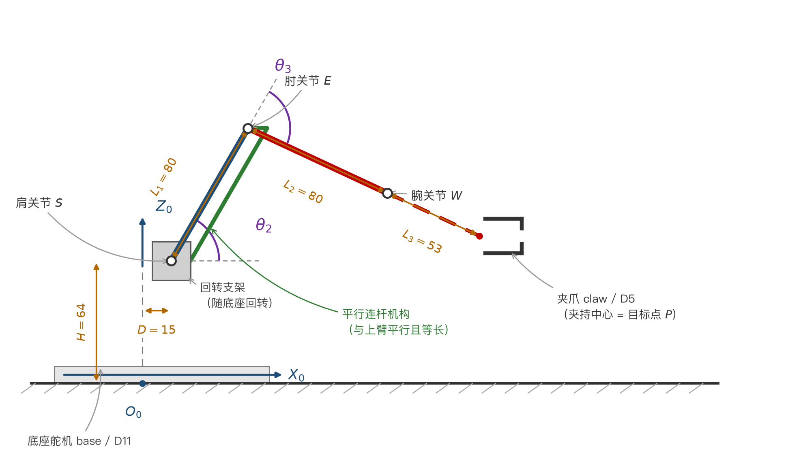
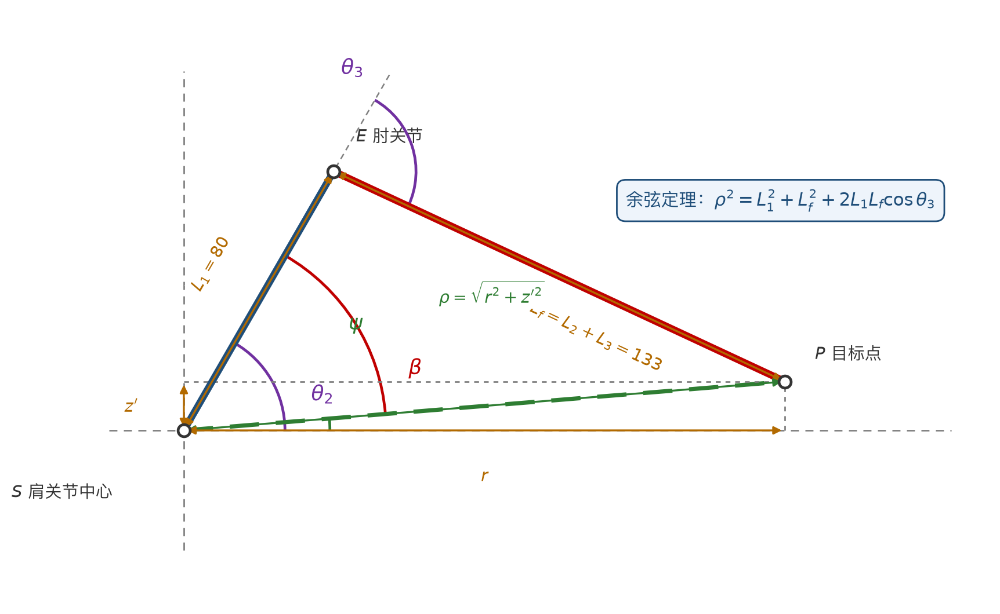

## 摘要

本文针对 meArm 四自由度桌面机械臂，建立其运动学模型并完成正、逆解推导。首先分析机械臂的自由度构成，指出夹爪开合不影响末端夹持中心位置，因而末端位置由底座回转、肩关节俯仰与肘关节俯仰三个关节唯一确定；随后说明 meArm 肘关节所采用的**平行连杆（parallelogram linkage）**结构使肘关节转角与肩关节转角解耦，从而整条手臂可等效为"底座回转 + 垂直平面内 2R 串联平面臂"。在此基础上，采用标准 D-H 参数法建立各连杆的齐次变换矩阵并推导出运动学正解；采用几何法（余弦定理与反正切分解）推导出解析形式的运动学逆解，给出肘上、肘下两组解的判别方式、可达性条件与奇异位形。最后以具体数值算例验证了正逆解的一致性与正确性，并给出关节角到舵机角度的映射与标定方法，为后续任务（轨迹绘制）提供解算基础。

**关键词**：meArm 机械臂；D-H 参数法；运动学正解；运动学逆解；平行连杆

## 一、任务说明与建模对象

### 1.1 题目要求

对 meArm 机械臂进行运动学正解与逆解推导，给出该机械臂的运动学方程，并以 Word 公式形式完整表述推导过程。

### 1.2 机械臂构型分析

meArm 为四自由度（4-DOF）串联式桌面机械臂，各自由度构成如表 1-1 所示。

表 1-1 meArm 自由度构成

| 关节 | 名称 | 运动形式 | 程序中对应的舵机与引脚 | 是否影响末端位置 |
| :---: | :---: | :---: | :---: | :---: |
| $J_1$ | 底座回转（base） | 绕竖直轴转动 | `base`，D11 | 是 |
| $J_2$ | 肩关节（shoulder） | 绕水平轴俯仰 | `rArm`，D10 | 是 |
| $J_3$ | 肘关节（elbow） | 绕水平轴俯仰 | `fArm`，D9 | 是 |
| $J_4$ | 夹爪开合（gripper） | 末端平动开合 | `claw`，D5 | 否 |

其中第 $J_4$ 关节只改变夹爪的开口宽度，不改变被夹持物体的中心位置，因此**末端的空间位置仅由 $J_1$、$J_2$、$J_3$ 三个关节决定**。本文讨论的是这一 3 自由度位置机构的运动学。

### 1.3 平行连杆结构的解耦作用

meArm 的一个关键结构特征是：**肘关节舵机并不安装在肘部**，而是与肩关节舵机一同固定在底座上方的回转支架上；肘关节的运动通过一组**平行连杆机构**从底座侧传递至肘部，如图 1-1 所示。

在该四杆机构中，底座侧的主动摇杆与肘部的从动摇杆等长，二者由一根与上臂等长的连杆相连，四杆的边长构成两组平行且相等的对边，因而是一个**平行四边形机构**。平行四边形机构的运动学性质是：**连杆（coupler）在运动过程中相对机架保持固定的姿态**。由此可直接得到：

$$\theta_3 = \theta_{3}^{\,s} + b_3$$

式中 $\theta_{3}^{\,s}$ 为肘舵机输出轴的转角，$b_3$ 为装配常数。也就是说，**肘关节的相对转角只取决于肘舵机本身，而与肩关节转角无关**。这一解耦特性带来两点重要结论：

1. 肩、肘两个转动可视为**相互独立的串联转动关节**，不必处理驱动耦合项；
2. 整条手臂可等效为"**底座回转 + 垂直平面内 2R 串联平面臂**"，从而能够获得封闭形式的解析逆解。

### 1.4 建模假设

1. 各连杆视为刚性杆件，忽略装配间隙、弹性变形与齿轮回差；
2. 夹爪开合不改变被夹持物体的中心位置，故不进入位置方程；
3. 肩、肘两关节的转轴严格平行（由同一块支架上的安装孔保证）；
4. 舵机零位与理论关节零位之间的固定偏差，统一在第 5 节以线性映射补偿；
5. 忽略负载、温度变化对连杆几何尺寸的影响。

## 二、坐标系建立与连杆参数

### 2.1 基坐标系

建立基坐标系 $O_0-X_0Y_0Z_0$，如图 1-1 与图 2-1 所示：

- **原点 $O_0$**：底座回转轴线与机械臂安装底面（桌面）的交点；
- **$Z_0$ 轴**：沿底座回转轴线竖直向上；
- **$X_0$ 轴**：水平指向机械臂正前方（即 $\theta_1=0$ 时手臂伸出的方向）；
- **$Y_0$ 轴**：由右手定则确定。

以原点 $O_0$ 为基准，末端夹持中心的位置记为 $\boldsymbol{P}=\left(x,\ y,\ z\right)^{\mathrm{T}}$。

### 2.2 关节角的定义与正方向

| 关节角 | 定义 | 正方向 |
| :---: | :--- | :--- |
| $\theta_1$ | 底座回转角，手臂在水平面内的方位角 | 绕 $Z_0$ 轴逆时针（俯视） |
| $\theta_2$ | 肩关节角，大臂与水平面的夹角 | 大臂向上抬起为正 |
| $\theta_3$ | 肘关节角，小臂相对大臂的转角 | 小臂相对大臂向上折为正，$\theta_3=0$ 时大臂小臂共线（手臂完全伸直） |

由图 1-1 可直接读出，小臂（含夹爪）相对水平面的方向角为 $\theta_2+\theta_3$。

### 2.3 连杆参数

| 参数 | 含义 | 取值 / mm |
| :---: | :--- | :---: |
| $D$ | 底座回转轴线 → 肩关节轴线的水平偏置 | 15 |
| $H$ | 安装底面 → 肩关节轴线的高度 | 64 |
| $L_1$ | 大臂长度（肩关节轴线 → 肘关节轴线） | 80 |
| $L_2$ | 小臂长度（肘关节轴线 → 腕关节轴线） | 80 |
| $L_3$ | 腕关节轴线 → 夹爪夹持中心 | 53 |
| $L_f$ | 等效小臂长度，$L_f = L_2 + L_3$ | 133 |

> **参数来源说明**：$L_1=80\ \mathrm{mm}$、$L_2=80\ \mathrm{mm}$ 与 meArm 官方运动学库（`yorkhackspace/meArm` 的 `config.h`）的默认值一致；该库把"底座回转轴 → 肩关节轴的水平偏置"与"腕轴 → 夹爪夹持中心"合并为一个参数 $L_3'=68\ \mathrm{mm}$。本文为便于推导将二者分开，分别记作 $D$ 与 $L_3$，取 $D=15\ \mathrm{mm}$、$H=64\ \mathrm{mm}$，则 $L_3 = L_3' - D \approx 53\ \mathrm{mm}$。上述取值为套件标称值，实际尺寸随批次与装配存在差异，**建议按附录 A 实测后替换表 2-3 中的数值**；本文全部公式为一般形式，替换参数不影响推导结论。

## 三、运动学正解

运动学正解解决的问题是：**已知关节角 $\theta_1,\theta_2,\theta_3$，求末端夹持中心的位置 $\boldsymbol{P}$**。

### 3.1 基于标准 D-H 参数法的推导

#### 3.1.1 连杆坐标系与 D-H 参数表

按标准 D-H（Denavit-Hartenberg）约定，第 $i$ 个连杆的齐次变换矩阵为

$$A_i = \mathrm{Rot}_z(\theta_i)\,\mathrm{Trans}_z(d_i)\,\mathrm{Trans}_x(a_i)\,\mathrm{Rot}_x(\alpha_i)$$

其中四个基本变换分别为

$$\mathrm{Rot}_z(\theta)=\begin{bmatrix}\cos\theta & -\sin\theta & 0 & 0\\ \sin\theta & \cos\theta & 0 & 0\\ 0 & 0 & 1 & 0\\ 0 & 0 & 0 & 1\end{bmatrix},\qquad \mathrm{Trans}_z(d)=\begin{bmatrix}1&0&0&0\\0&1&0&0\\0&0&1&d\\0&0&0&1\end{bmatrix}$$

$$\mathrm{Trans}_x(a)=\begin{bmatrix}1&0&0&a\\0&1&0&0\\0&0&1&0\\0&0&0&1\end{bmatrix},\qquad \mathrm{Rot}_x(\alpha)=\begin{bmatrix}1&0&0&0\\0&\cos\alpha&-\sin\alpha&0\\0&\sin\alpha&\cos\alpha&0\\0&0&0&1\end{bmatrix}$$

按第 2.2 节的关节角定义与第 2.1 节的基坐标系，建立的 D-H 参数表如表 3-1。

表 3-1 meArm 的标准 D-H 参数表

| 连杆 $i$ | 关节变量 $\theta_i$ | 连杆偏置 $d_i$ | 连杆长度 $a_i$ | 连杆扭角 $\alpha_i$ |
| :---: | :--- | :---: | :---: | :---: |
| 1 | $\theta_1$（底座回转） | $H$ | $D$ | $+90^{\circ}$ |
| 2 | $\theta_2$（肩关节） | 0 | $L_1$ | $0^{\circ}$ |
| 3 | $\theta_3$（肘关节） | 0 | $L_2$ | $0^{\circ}$ |
| 4 | $\theta_4 = 0$（夹爪固定） | 0 | $L_3$ | $0^{\circ}$ |

说明：第 1 连杆的扭角取 $+90^{\circ}$，使 $Z_1$ 轴由竖直变为水平，与肩关节的实际转轴方向一致；由于夹爪相对小臂是固定安装（无独立腕关节），故 $\theta_4$ 恒为常数 $0$。

#### 3.1.2 各连杆变换矩阵

将表 3-1 的参数逐一代入 $A_i$ 的通式，得

$$A_1=\begin{bmatrix} c_1 & 0 & s_1 & Dc_1\\ s_1 & 0 & -c_1 & Ds_1\\ 0 & 1 & 0 & H\\ 0&0&0&1\end{bmatrix},\qquad A_2=\begin{bmatrix} c_2 & -s_2 & 0 & L_1c_2\\ s_2 & c_2 & 0 & L_1s_2\\ 0 & 0 & 1 & 0\\ 0&0&0&1\end{bmatrix}$$

$$A_3=\begin{bmatrix} c_3 & -s_3 & 0 & L_2c_3\\ s_3 & c_3 & 0 & L_2s_3\\ 0 & 0 & 1 & 0\\ 0&0&0&1\end{bmatrix},\qquad A_4=\begin{bmatrix} 1 & 0 & 0 & L_3\\ 0 & 1 & 0 & 0\\ 0 & 0 & 1 & 0\\ 0&0&0&1\end{bmatrix}$$

式中简记 $s_i=\sin\theta_i$，$c_i=\cos\theta_i$（下同）。

#### 3.1.3 末端位姿矩阵

末端相对基坐标系的位姿为各连杆变换之积：

$$T_{4}=A_1A_2A_3A_4=\begin{bmatrix} \boldsymbol{n} & \boldsymbol{o} & \boldsymbol{a} & \boldsymbol{p}\\ 0&0&0&1\end{bmatrix}$$

先合并后两个关节的转角。注意到 $A_2$、$A_3$ 的旋转部分均为绕 $Z$ 轴的转动，其乘积只与 $\theta_2+\theta_3$ 有关：

$$A_2A_3=\begin{bmatrix} c_{23} & -s_{23} & 0 & L_1c_2+L_2c_{23}\\ s_{23} & c_{23} & 0 & L_1s_2+L_2s_{23}\\ 0&0&1&0\\ 0&0&0&1\end{bmatrix}$$

其中 $c_{23}=\cos(\theta_2+\theta_3)$，$s_{23}=\sin(\theta_2+\theta_3)$。再左乘 $A_1$、右乘 $A_4$，并令 $L_f=L_2+L_3$，得末端位姿矩阵：

$$T_{4}=\begin{bmatrix} c_1c_{23} & -c_1s_{23} & s_1 & c_1\!\left(D+L_1c_2+L_fc_{23}\right)\\[2pt] s_1c_{23} & -s_1s_{23} & -c_1 & s_1\!\left(D+L_1c_2+L_fc_{23}\right)\\[2pt] s_{23} & c_{23} & 0 & H+L_1s_2+L_fs_{23}\\[2pt] 0&0&0&1\end{bmatrix}$$

#### 3.1.4 正解方程

取上式第 4 列的前三个元素，即得运动学正解方程：

$$x = \cos\theta_1\left(D+L_1\cos\theta_2+L_f\cos(\theta_2+\theta_3)\right)$$
$$y = \sin\theta_1\left(D+L_1\cos\theta_2+L_f\cos(\theta_2+\theta_3)\right)$$
$$z = H+L_1\sin\theta_2+L_f\sin(\theta_2+\theta_3)$$

同时，末端姿态矩阵（旋转部分）为

$$R_{4}=\begin{bmatrix} c_1c_{23} & -c_1s_{23} & s_1\\ s_1c_{23} & -s_1s_{23} & -c_1\\ s_{23} & c_{23} & 0\end{bmatrix}=\mathrm{Rot}_z(\theta_1)\,\mathrm{Rot}_x(90^{\circ})\,\mathrm{Rot}_z(\theta_2+\theta_3)$$

由于夹爪相对小臂固定，其姿态只由 $\theta_1$ 与 $\theta_2+\theta_3$ 决定，不存在独立的姿态自由度——这与 meArm 为 3 自由度位置机构（外加夹爪开合）的构型一致。

### 3.2 基于几何投影的验证

正解方程亦可由几何关系直接得到，用以验证上式。由图 1-1，把一个三维问题分解为"水平面的回转"与"竖直平面内的平面臂"两部分。

第一步，求肩关节中心在基坐标系中的位置。肩关节位于底座回转轴线上方 $H$、并沿 $X_0$ 方向前移 $D$，则

$$\boldsymbol{P}_{s}=\left(D\cos\theta_1,\ D\sin\theta_1,\ H\right)^{\mathrm{T}}$$

第二步，在竖直平面内叠加两段连杆的位移。大臂在水平面内的投影为 $L_1\cos\theta_2$，竖直投影为 $L_1\sin\theta_2$；等效小臂（含夹爪）相对水平面的方向角为 $\theta_2+\theta_3$，其水平投影为 $L_f\cos(\theta_2+\theta_3)$，竖直投影为 $L_f\sin(\theta_2+\theta_3)$。沿 $X_0$ 方向的"伸出半径"记为

$$R=D+L_1\cos\theta_2+L_f\cos(\theta_2+\theta_3)$$

则

$$x=R\cos\theta_1,\qquad y=R\sin\theta_1,\qquad z=H+L_1\sin\theta_2+L_f\sin(\theta_2+\theta_3)$$

与 3.1.4 节结果完全一致，正解推导得到相互印证。

## 四、运动学逆解

运动学逆解解决的问题是：**已知末端夹持中心的目标位置 $\boldsymbol{P}=\left(x,y,z\right)^{\mathrm{T}}$，求对应的关节角 $\theta_1,\theta_2,\theta_3$**。

### 4.1 求解思路

meArm 的肩、肘两轴共面（均垂直于手臂所在的竖直平面），底座轴垂直于该平面，满足"**一轴垂直 + 平面双连杆**"的典型可解结构，因此可采用**解析法（几何法）**求解，无需数值迭代。求解分三步：

1. **由底座回转解耦**：用 $\theta_1=\mathrm{atan2}(y,x)$ 先消去水平方位，把三维问题降为二维；
2. **在竖直平面内解算**：以肩关节中心为原点、目标点到肩关节中心的距离 $\rho$ 为斜边，构造由 $L_1$、$L_f$、$\rho$ 组成的三角形，用余弦定理求肘角 $\theta_3$；
3. **回代求肩角**：由三角形的方位关系解出 $\theta_2$。

逆解的几何构造如图 4-1 所示。

### 4.2 步骤一：求解底座回转角 $\theta_1$

由正解方程可知，末端在水平面内的投影方向与 $\theta_1$ 完全一致，且当 $R>0$ 时 $\theta_1$ 与 $x,y$ 的关系为

$$\theta_1=\mathrm{atan2}\left(y,\ x\right)$$

注意此处必须使用四象限反正切函数 $\mathrm{atan2}$ 而不能使用 $\arctan(y/x)$：后者只能给出 $(-90^{\circ},90^{\circ})$ 的取值范围，无法区分机械臂指向"正前方偏左"与"正后方偏右"两种情形。

### 4.3 步骤二：降维到竖直平面

将目标点变换到肩关节中心的坐标系中。记水平半径（扣除底座到肩关节的水平偏置 $D$）与相对肩关节的高度分别为

$$r=\sqrt{x^{2}+y^{2}}-D,\qquad z'=z-H$$

则目标点到肩关节中心的距离为

$$\rho=\sqrt{r^{2}+z'^{2}}$$

此时问题已完全降维为"在竖直平面内，已知目标点 $(r,\ z')$，求两连杆转角 $\theta_2$、$\theta_3$"，即经典的平面 2R 机构逆解问题。

### 4.4 步骤三：由余弦定理求解肘关节角 $\theta_3$

由正解方程第 1、3 式，两连杆末端位置满足

$$r=L_1\cos\theta_2+L_f\cos(\theta_2+\theta_3),\qquad z'=L_1\sin\theta_2+L_f\sin(\theta_2+\theta_3)$$

将两式平方相加，利用 $\cos^{2}\alpha+\sin^{2}\alpha=1$ 化简：

$$\rho^{2}=r^{2}+z'^{2}=L_1^{2}+L_f^{2}+2L_1L_f\cos\theta_3$$

上式即由 $L_1$、$L_f$、$\rho$ 构成的三角形的余弦定理（$\theta_3=0$ 时两连杆共线，$\rho=L_1+L_f$，与上式一致）。由此解得

$$\boxed{\;\cos\theta_3=\dfrac{r^{2}+z'^{2}-L_1^{2}-L_f^{2}}{2L_1L_f}=\dfrac{\rho^{2}-L_1^{2}-L_f^{2}}{2L_1L_f}\;}$$

$$\theta_3=\pm\arccos\!\left(\frac{\rho^{2}-L_1^{2}-L_f^{2}}{2L_1L_f}\right)$$

### 4.5 步骤四：求解肩关节角 $\theta_2$

设目标点相对肩关节中心的方位角为

$$\psi=\mathrm{atan2}\left(z',\ r\right)$$

再设大臂与"肩关节中心指向目标点"的连线之间的夹角为 $\beta$。该角即 $\triangle(S,\ E,\ P)$ 在肩关节 $S$ 处的内角，由三角形边角关系可得

$$\beta=\mathrm{atan2}\!\left(L_f\sin\theta_3,\ L_1+L_f\cos\theta_3\right)$$

于是肩关节角为方位角与该内角之差：

$$\boxed{\;\theta_2=\mathrm{atan2}\left(z',\ r\right)-\mathrm{atan2}\!\left(L_f\sin\theta_3,\ L_1+L_f\cos\theta_3\right)\;}$$

当机械臂向下俯（$z'<0$）或向后伸（$r<0$）时，$\mathrm{atan2}$ 会返回相应的象限角，$\theta_2$ 可自动取到正确符号。

### 4.6 逆解的两组解与构型选择

余弦定理给出的 $\theta_3=\pm\arccos(\cdot)$ 对应两组解，二者末端位置完全相同，区别仅在于肘关节的朝向：

| 解 | 肘关节角 | 几何含义 | 典型姿态 |
| :---: | :---: | :--- | :--- |
| 解 A | $\theta_3<0$ | 肘关节位于"肩—目标"连线的**上方** | 肘上构型（肘关节朝上，meArm 常用姿态） |
| 解 B | $\theta_3>0$ | 肘关节位于"肩—目标"连线的**下方** | 肘下构型 |

因此逆解是**多解**的（一般情形下为 2 组），工程实现中必须给出选解准则。常用的准则有两条：

1. **贴近当前姿态准则**：选择与机械臂当前关节角最接近的一组解，使关节运动量最小、避免运动中发生肘部翻转。实现上可比较两组解与当前角的差的绝对值之和，取较小者；
2. **固定构型准则**：始终固定使用肘上构型（或肘下构型），保证动作风格一致。任务五的连续轨迹绘制宜采用本条准则，避免绘制过程中肘部突然翻转导致笔尖跳动。

此外还须用关节的机械限位对两组解进行筛选，剔除超出舵机行程的解。

### 4.7 可达性与工作空间

由 $\left|\cos\theta_3\right|\le 1$ 可得逆解存在（目标点可达）的条件为

$$\left|\,L_1-L_f\,\right|\ \le\ \rho\ \le\ L_1+L_f$$

代入本文参数得 $53\ \mathrm{mm}\le\rho\le 213\ \mathrm{mm}$。该条件的几何意义是：**末端可达点必须落在以肩关节中心为球心、内径 $|L_1-L_f|$、外径 $L_1+L_f$ 的球壳内**（再受各关节转角的机械限位与底座回转角的限制截取）。

当 $\rho>L_1+L_f$ 时目标点超出机械臂的最大伸展范围（例如取 $L_1=L_2=80$、$L_3=53$、$D=15$，则从底座轴线算起的最大水平伸展为 $D+L_1+L_f=228\ \mathrm{mm}$）；当 $\rho<|L_1-L_f|$ 时目标点落入机械臂"折叠盲区"，即使完全收拢也无法触及。工程实现时应在逆解入口处先做该项检查，并对 $\cos\theta_3$ 做限幅钳位处理，避免 $\arccos$ 的定义域越界而产生 NaN。

### 4.8 奇异位形

当 $\theta_3\to 0$ 时（即 $\rho\to L_1+L_f$，机械臂完全伸直），$\beta=\mathrm{atan2}(0,\ L_1+L_f)=0$，此时 $\theta_3$ 的符号不可分辨，两组解退化为同一组——这是**边界奇异位形**，雅可比矩阵降秩，末端在径向失去运动能力。当 $\theta_3\to\pm 180^{\circ}$（完全折叠）时同样出现奇异。

在任务五的轨迹规划中，应避免让目标点落在工作空间的内外边界上，或在接近边界时降低运动速度，以保证运动平稳、避免关节角速率发散。

## 五、关节角与舵机角度的映射

前述逆解给出的是**关节角** $\left(\theta_1,\theta_2,\theta_3\right)$，而程序下发的是**舵机角度指令** $a_i$，二者之间存在由机械安装方向与舵机零位共同决定的线性关系。在 $0\sim 180^{\circ}$ 的工作区间内，舵机的角度指令与实际输出轴转角近似为线性，故可设为

$$a_i=a_i^{0}+\sigma_i\,\theta_i,\qquad i=1,2,3$$

式中 $a_i^{0}$ 为关节角为零时对应的舵机中位角，$\sigma_i=\pm 1$ 由该关节的安装方向决定（关节正方向与舵机角度增大的方向一致时取 $+1$，相反时取 $-1$）。

$\sigma_i$ 与 $a_i^{0}$ 可由**两点标定法**确定：将关节手动置于两个不同的已知关节角 $\theta_i^{(1)}$、$\theta_i^{(2)}$，记录对应的舵机读数 $a_i^{(1)}$、$a_i^{(2)}$，则

$$\sigma_i=\mathrm{sgn}\!\left(\frac{a_i^{(2)}-a_i^{(1)}}{\theta_i^{(2)}-\theta_i^{(1)}}\right),\qquad a_i^{0}=a_i^{(1)}-\sigma_i\,\theta_i^{(1)}$$

采用两点标定而非直接测量装配尺寸，可一并把舵机零位偏差、舵盘齿位误差与机械安装角度一并补偿。各关节的舵机行程限位如表 5-1。

表 5-1 各关节的舵机行程与程序变量对应关系

| 关节角 | 舵机变量 | 引脚 | 程序中的舵机角度范围 |
| :---: | :---: | :---: | :---: |
| $\theta_1$ | `base` | D11 | $0^{\circ}\sim 180^{\circ}$ |
| $\theta_2$ | `rArm` | D10 | $20^{\circ}\sim 110^{\circ}$ |
| $\theta_3$ | `fArm` | D9 | $40^{\circ}\sim 130^{\circ}$ |
| 夹爪 | `claw` | D5 | $25^{\circ}\sim 100^{\circ}$ |

逆解算出的关节角须经上式转换为舵机角度后，再用表 5-1 的行程范围做限幅校验；若越限，则该目标点在本机实际不可达。

## 六、数值算例与验证

### 6.1 算例

取表 2-3 的参数：$D=15\ \mathrm{mm}$，$H=64\ \mathrm{mm}$，$L_1=80\ \mathrm{mm}$，$L_2=80\ \mathrm{mm}$，$L_3=53\ \mathrm{mm}$，故 $L_f=L_2+L_3=133\ \mathrm{mm}$。

**目标点**：$\boldsymbol{P}=\left(170,\ 0,\ 64\right)^{\mathrm{T}}\ \mathrm{mm}$，即位于机械臂正前方、与肩关节轴线同一高度处的一点。

**第一步**，求底座回转角：

$$\theta_1=\mathrm{atan2}(0,\ 170)=0^{\circ}$$

**第二步**，降到竖直平面：

$$r=\sqrt{170^{2}+0^{2}}-D=170-15=155\ \mathrm{mm}$$

$$z'=z-H=64-64=0\ \mathrm{mm}$$

$$\rho^{2}=r^{2}+z'^{2}=155^{2}+0^{2}=24025\ \mathrm{mm}^{2}\ \Longrightarrow\ \rho=155\ \mathrm{mm}$$

**第三步**，由余弦定理求肘关节角：

$$\cos\theta_3=\frac{\rho^{2}-L_1^{2}-L_f^{2}}{2L_1L_f}=\frac{24025-6400-17689}{2\times 80\times 133}=\frac{-64}{21280}=-0.003008$$

$$\theta_3=\pm\arccos\left(-0.003008\right)=\pm\,90.172^{\circ}$$

**第四步**，求肩关节角。由 $\psi=\mathrm{atan2}(0,155)=0^{\circ}$，以及对解 A（$\theta_3=-90.172^{\circ}$）：

$$\beta=\mathrm{atan2}\!\left(133\sin(-90.172^{\circ}),\ 80+133\cos(-90.172^{\circ})\right)=\mathrm{atan2}\left(-132.999,\ 79.600\right)=-59.100^{\circ}$$

$$\theta_2=\psi-\beta=0^{\circ}-(-59.100^{\circ})=59.100^{\circ}$$

两组逆解的结果汇总如表 6-1。

表 6-1 目标点 $(170,0,64)$ 的两组逆解

| 解 | $\theta_1$ | $\theta_2$ | $\theta_3$ | 构型 |
| :---: | :---: | :---: | :---: | :--- |
| 解 A | $0^{\circ}$ | $+59.100^{\circ}$ | $-90.172^{\circ}$ | 肘上（大臂上抬约 $59^{\circ}$，小臂下折约 $90^{\circ}$） |
| 解 B | $0^{\circ}$ | $-59.100^{\circ}$ | $+90.172^{\circ}$ | 肘下 |

### 6.2 正逆解一致性验证

将表 6-1 的两组解分别代回第 3.1.4 节的正解方程，检验能否还原原目标点。

**解 A**（$\theta_1=0^{\circ}$，$\theta_2=59.100^{\circ}$，$\theta_3=-90.172^{\circ}$）：

$$x=\cos 0^{\circ}\left(15+80\cos 59.100^{\circ}+133\cos(-31.072^{\circ})\right)=15+41.072+113.928=170.000\ \mathrm{mm}$$

$$y=\sin 0^{\circ}\times(\cdot)=0.000\ \mathrm{mm}$$

$$z=64+80\sin 59.100^{\circ}+133\sin(-31.072^{\circ})=64.000\ \mathrm{mm}$$

**解 B**：同理可算得回代结果同为 $\left(170.000,\ 0.000,\ 64.000\right)^{\mathrm{T}}\ \mathrm{mm}$。可见两组解对应同一末端位置，与 4.6 节的结论相符。

### 6.3 多目标点验证

为进一步验证逆解公式的正确性，另取若干目标点算解并回代，结果如表 6-2。表中"回代误差"为目标点坐标与用逆解结果正解回代所得坐标之差的绝对值。

表 6-2 多目标点逆解与回代验证（均取肘上构型）

| 目标点 $(x,y,z)$ /mm | $\theta_1$ | $\theta_2$ | $\theta_3$ | 回代误差 /mm |
| :---: | :---: | :---: | :---: | :---: |
| $(170,\ 0,\ 64)$ | $0.000^{\circ}$ | $+59.100^{\circ}$ | $-90.172^{\circ}$ | $<10^{-13}$ |
| $(140,\ 60,\ 100)$ | $23.199^{\circ}$ | $+81.724^{\circ}$ | $-100.663^{\circ}$ | $<10^{-13}$ |
| $(90,\ -110,\ 50)$ | $-50.711^{\circ}$ | $+69.376^{\circ}$ | $-111.305^{\circ}$ | $<10^{-13}$ |
| $(200,\ 0,\ 128)$ | $0.000^{\circ}$ | $+49.421^{\circ}$ | $-48.026^{\circ}$ | $<10^{-13}$ |
| $(120,\ 90,\ 150)$ | $36.870^{\circ}$ | $+88.470^{\circ}$ | $-85.872^{\circ}$ | $0$ |

各点的回代误差均在 $10^{-13}\ \mathrm{mm}$ 量级（计算机浮点运算的舍入误差水平），表明本文推导的正、逆解公式严格自洽。

### 6.4 可达性检查示例

以第 4.7 节的判据检验以下三点的可达性，结果如表 6-3。

表 6-3 可达性检查

| 目标点 /mm | 距肩关节中心的距离 $\rho$ /mm | 判据 $53\le\rho\le 213$ | 结论 |
| :---: | :---: | :---: | :---: |
| $(300,\ 0,\ 100)$ | $287.26$ | 不满足 | 超出最大伸展范围，不可达 |
| $(15,\ 0,\ 64)$ | $0.00$ | 不满足 | 落在底座轴线上，落入折叠盲区，不可达 |
| $(15,\ 0,\ 200)$ | $136.00$ | 满足 | 可达 |

## 七、结论

本文完成了 meArm 四自由度机械臂的运动学建模与正、逆解推导，主要结论如下：

1. **构型简化**：meArm 的夹爪开合不参与末端定位，其肘关节由平行连杆从底座侧驱动。平行四边形机构的"连杆姿态保持不变"特性，使肘关节转角与肩关节转角解耦，因而整条手臂严格等效为"底座回转 + 垂直平面内 2R 串联平面臂"，为解析求逆提供了前提。

2. **运动学正解**（式 3.1.4）：

$$x=\cos\theta_1\left(D+L_1\cos\theta_2+L_f\cos(\theta_2+\theta_3)\right)$$
$$y=\sin\theta_1\left(D+L_1\cos\theta_2+L_f\cos(\theta_2+\theta_3)\right)$$
$$z=H+L_1\sin\theta_2+L_f\sin(\theta_2+\theta_3)$$

3. **运动学逆解**（式 4.4、4.5）：

$$\theta_1=\mathrm{atan2}(y,x),\qquad r=\sqrt{x^{2}+y^{2}}-D,\qquad z'=z-H$$
$$\theta_3=\pm\arccos\!\left(\frac{r^{2}+z'^{2}-L_1^{2}-L_f^{2}}{2L_1L_f}\right)$$
$$\theta_2=\mathrm{atan2}(z',r)-\mathrm{atan2}\!\left(L_f\sin\theta_3,\ L_1+L_f\cos\theta_3\right)$$

4. **多解与可达性**：逆解一般有两组（肘上、肘下），需按"贴近当前姿态"或"固定构型"准则选解；可达性由 $\left|L_1-L_f\right|\le\rho\le L_1+L_f$ 判定，$\theta_3\to 0$ 与 $\theta_3\to\pm180^{\circ}$ 处为奇异位形。

5. **数值验证**：以 $(170,0,64)\ \mathrm{mm}$ 为例的完整算例与多目标点回代验证表明，逆解结果代回正解后与原目标点的偏差在 $10^{-13}\ \mathrm{mm}$ 量级，公式正确、自洽。

6. **工程接口**：逆解所得关节角经线性映射 $a_i=a_i^{0}+\sigma_i\theta_i$ 转换为舵机角度，映射系数由两点标定法确定，并须用表 5-1 的舵机行程做限位校验。该接口即为后续"轨迹绘制"任务的解算基础：把纸面上的一系列目标点 $(x,y,z)$ 逐点送入逆解，再经插值下发到四个舵机，即可控制笔尖沿期望轨迹运动。

## 附录 A 连杆参数的标定方法

由于套件存在加工公差与装配误差，表 2-3 的参数应实测后替换。测量方法如下。

| 参数 | 测量方法 | 测量基准 |
| :---: | :--- | :--- |
| $L_1$ | 大臂两端转轴的**中心距** | 肩关节轴线 → 肘关节轴线 |
| $L_2$ | 小臂两端转轴的**中心距** | 肘关节轴线 → 腕关节轴线 |
| $L_3$ | 腕关节轴线到夹爪两指闭合时的**夹持中心**的直线距离 | 沿小臂轴线方向 |
| $H$ | 安装底面到肩关节轴线的**高度** | 竖直方向 |
| $D$ | 底座回转轴线到肩关节轴线的**水平距离** | 从机械臂侧面（沿转轴方向）观察测量 |

测量时建议使用游标卡尺或将机械臂拆下平放在坐标纸上取中心距；由于轴孔中心不易直接定位，可测量外轮廓后再扣除同轴半径，取多次测量的平均值。参数替换后本文全部公式均可直接沿用（公式为一般形式，不依赖具体数值）。

## 附录 B 程序变量与公式符号的对应关系

| 公式符号 | 含义 | 程序中对应的量 |
| :---: | :--- | :--- |
| $\theta_1$ | 底座回转角 | 舵机 `base`（D11）的目标角度 |
| $\theta_2$ | 肩关节角（大臂） | 舵机 `rArm`（D10）的目标角度 |
| $\theta_3$ | 肘关节角（小臂） | 舵机 `fArm`（D9）的目标角度 |
| $a_1,a_2,a_3$ | 上述三个关节的舵机指令角度 | `basePos`、`rArmPos`、`fArmPos` |
| $(x,y,z)$ | 末端夹持中心在基坐标系中的位置 | 逆解的输入；任务五中的笔尖目标点 |

需要特别提醒：程序中的变量名 `x` / `y` / `z` 在任务一是**舵机编号**（其参数为角度），而本文中的 $x$ / $y$ / $z$ 是**笛卡尔坐标**（单位为毫米），二者同名而含义完全不同。编写任务五的控制程序时，建议将坐标量统一命名为 `px` / `py` / `pz` 以示区别，避免误用。
